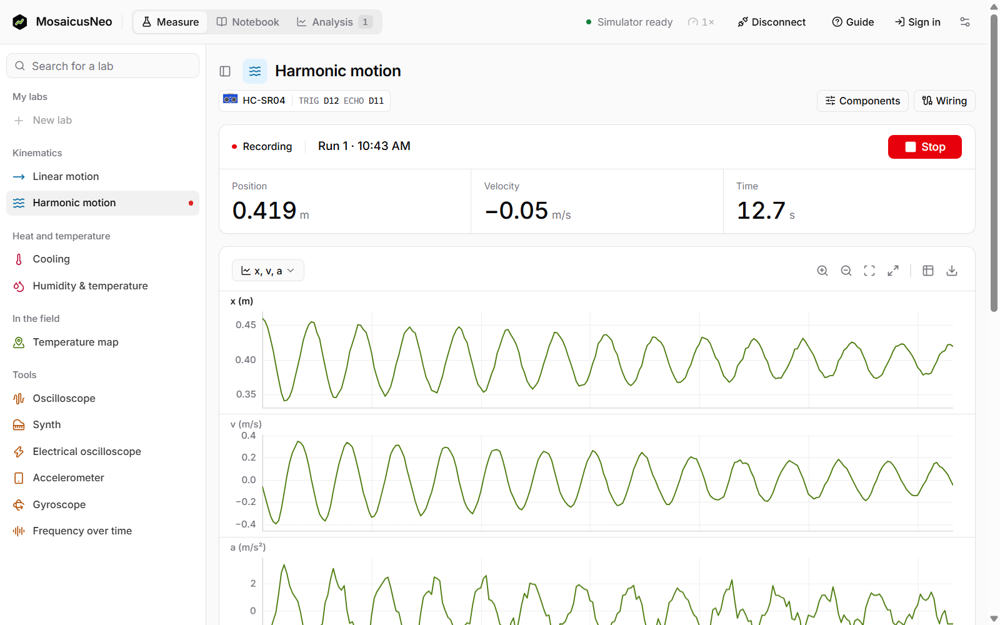
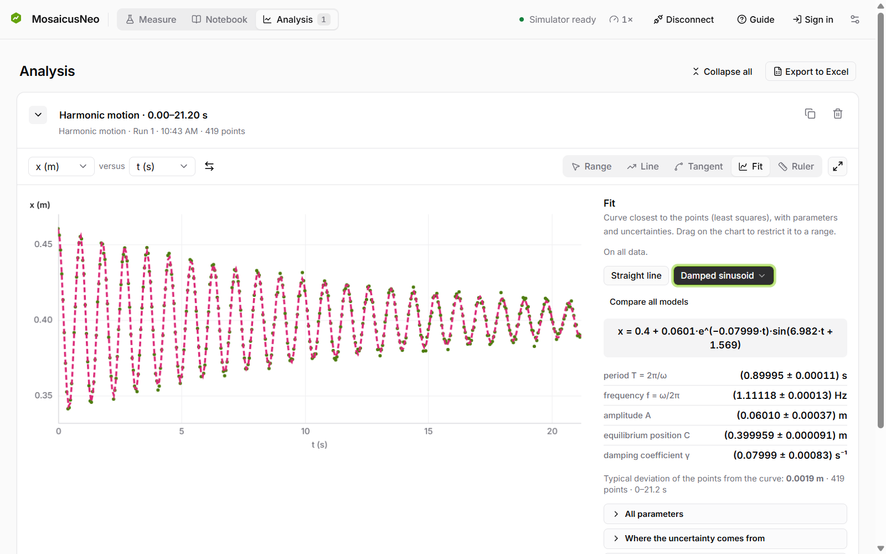
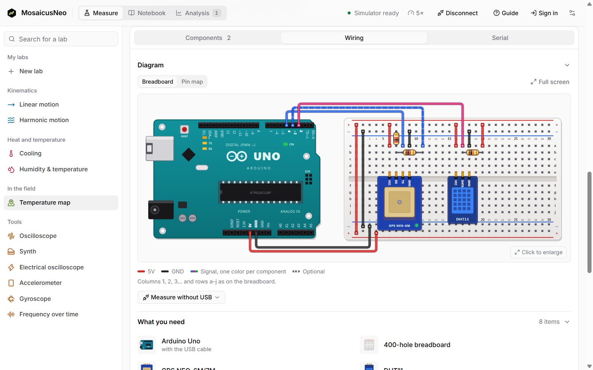

<p align="center"><a href="README.md">English</a> · <b>Italiano</b></p>

<p align="center">
  
</p>

<h1 align="center">MosaicusNeo</h1>

<p align="center">
  Un laboratorio di fisica nel browser, libero e open source, pensato per le scuole superiori.<br />
  Colleghi i sensori ad Arduino, registri dati veri e li analizzi subito.
</p>

<p align="center">
  <a href="https://mosaicusneo.alexcorazza.com"><b>Apri l'app</b></a> ·
  <a href="#per-iniziare">Per iniziare</a> ·
  <a href="#hardware">Hardware</a> ·
  <a href="#sviluppo">Sviluppo</a> ·
  <a href="https://github.com/Alexciao/MosaicusNeo/issues/new">Segnala un problema</a>
</p>



## Che cos'è

MosaicusNeo trasforma un Arduino Uno e qualche sensore economico in un piccolo laboratorio di acquisizione dati. Scegli un esperimento (o componi un tuo lab con i componenti che hai), l'app ti mostra esattamente come collegarlo, poi legge tutti i sensori insieme e disegna i grafici in tempo reale. Alla fine puoi adattare una curva ai dati con le incertezze, verificare i residui ed esportare in Excel o CSV.

- **Niente da installare.** Funziona in Chrome o Edge sul computer (via USB o Bluetooth) e sul telefono via Bluetooth. Si installa anche come app e funziona offline.
- **Nessun account obbligatorio.** Le misure restano nel browser. Un account facoltativo le sincronizza su tutti i tuoi dispositivi.
- **Si prova anche senza hardware.** Ogni lab ha un simulatore integrato.
- Interfaccia in **italiano e inglese**.

MosaicusNeo nasce da [**Mosaicus**](https://ermesfrosi.it) di **Ermes Ferdinando Rosi**, distribuito con licenza MIT. I motori di calcolo (fit, elaborazione dei segnali, grafici su canvas, formule, export XLSX) sono quelli di Mosaicus. MosaicusNeo ricostruisce l'interfaccia con Next.js, React e shadcn/ui, e aggiunge sensori modulari, guide ai collegamenti generate in automatico, Bluetooth, registrazione su scheda SD e sincronizzazione facoltativa nel cloud.

## Screenshot

| Fit di un modello con le incertezze | Guida ai collegamenti generata dai componenti |
|---|---|
|  |  |

Gli screenshot mostrano l'interfaccia in inglese; in italiano è la stessa.

## Per iniziare

### Provala senza hardware

1. Apri [mosaicusneo.alexcorazza.com](https://mosaicusneo.alexcorazza.com).
2. Scegli un esperimento dalla barra laterale, per esempio **Moto armonico**.
3. Premi **Simulatore** nella barra in alto, poi **Avvia**. I grafici di posizione, velocità e accelerazione si riempiono.
4. Premi **Ferma**, poi **Analizza tutta la misura**. In **Elaborazione** scegli **Fit** e prova il modello suggerito.

### Con un Arduino vero

1. **Carica il firmware, una volta sola.** Apri [`firmware/mosaicusneo_firmware/mosaicusneo_firmware.ino`](firmware/mosaicusneo_firmware/mosaicusneo_firmware.ino) nell'IDE di Arduino e caricalo su un Arduino Uno. Non servono librerie aggiuntive.
2. **Scegli un lab** nella barra laterale: un esperimento pronto, oppure **I miei lab → Nuovo lab** per scegliere tu i componenti.
3. **Collega i componenti.** Apri la scheda **Collegamenti**: trovi lo schema su breadboard per i tuoi componenti e i tuoi pin, l'occorrente e i passi, foro per foro.
4. **Collegati.** Inserisci il cavo USB e premi **Collega Arduino**. L'app manda da sola la configurazione dei sensori alla scheda.
5. **Misura.** Premi **Avvia**. Se vuoi, dai un nome alla misura: si salva da sola nel **Quaderno**.
6. **Analizza.** Trascina su un grafico per scegliere un tratto e mandalo a **Elaborazione**. Lì puoi tracciare una retta a occhio, la tangente, adattare un modello (retta, parabola, esponenziale, sinusoide smorzata, …), verificare i residui e misurare con il righello.
7. **Esporta.** Excel, CSV, PNG, GPX o GeoJSON. Ci sono anche i dati grezzi dei sensori, per Python, R o MATLAB.

La **Guida** dell'app (barra in alto) spiega tutto questo più nel dettaglio, compresa la soluzione dei problemi più comuni.

### Esperimenti pronti

| Argomento | Esperimenti |
|---|---|
| Cinematica | Moto rettilineo, Moto armonico |
| Termologia | Raffreddamento, Umidità e temperatura |
| Sul campo | Mappa della temperatura (GPS + temperatura) |
| Strumenti | Oscilloscopio audio, Synth, Oscilloscopio elettrico (A0), accelerometro e giroscopio del telefono, Frequenza nel tempo |

Puoi modificare qualsiasi esperimento: le modifiche si salvano come nuovo lab in **I miei lab**, e l'originale resta com'era.

## Hardware

Fino a **6 sensori** insieme su un solo Arduino Uno, anche dello stesso tipo (per esempio due termistori per confrontare due tazze). Ognuno ha i suoi pin e il suo ritmo di lettura, e l'app controlla che i pin non siano in conflitto.

| Sensore | Pin | Misura |
|---|---|---|
| Termistore NTC (partitore) | A0–A5 | temperatura, resistenza |
| DHT11 / DHT22 | digitale | temperatura, umidità relativa, punto di rugiada |
| Ultrasuoni HC-SR04 | TRIG + ECHO | posizione, velocità, accelerazione |
| GPS NEO-6M/7M | RX (+ TX) | posizione, altitudine, velocità, distanza |
| Fotoresistenza (partitore) | A0–A5 | luminosità relativa |
| Tensione analogica 0–5 V | A0–A5 | tensione, o una grandezza tarata y = k·V + q |
| Sonda DS18B20 (anche impermeabile) | digitale + 4,7 kΩ | temperatura (±0,5 °C) |
| Fotocellula / ingresso digitale | digitale (D2/D3 per tempi al µs) | stato, passaggi, periodo, tempo di oscuramento, velocità |
| Cella di carico + HX711 | DT + SCK | massa, forza |
| Accelerometro MPU-6050 (GY-521) | I2C | accelerazione sui 3 assi, velocità angolare |
| Termometro a infrarossi MLX90614 | I2C | temperatura di una superficie senza contatto |

**Extra** che non contano nei 6 posti:

- **Segnali di stato:** display OLED da 0,49", LED RGB e cicalino, che indicano se la scheda è in attesa, in ricerca, sta misurando o ha un problema.
- **Pulsante Avvia/Ferma:** fa come i pulsanti dell'app, oppure avvia da solo la registrazione su SD.
- **Scheda microSD:** prepari la scheda una volta via USB, poi registra a batteria senza computer. I file `.NEO` si importano poi nel Quaderno.
- **Bluetooth:** un HC-06 o un modulo BLE (HM-10, AT-09, HC-08) per misurare senza cavo, per esempio all'aperto con il telefono e un power bank. Il BLE funziona anche su iPhone, con il browser Bluefy.

Niente Arduino? Anche accelerometro, giroscopio e microfono del telefono funzionano come sensori.

### Browser supportati

| | Cavo USB | Bluetooth HC-06 | Bluetooth LE |
|---|---|---|---|
| Chrome / Edge sul computer | ✓ | se associato prima | ✓ |
| Chrome su Android | – | ✓ (Chrome 138+) | ✓ |
| iPhone / iPad | – | – | con Bluefy |

Safari e Firefox non supportano Web Serial né Web Bluetooth. Puoi comunque usare il simulatore, i sensori del telefono, il Quaderno e l'Elaborazione.

## Privacy

Senza account tutto resta nel browser e non viene inviato nulla. Il microfono si usa solo dal vivo e non viene mai registrato. Niente pubblicità, statistiche o cookie di profilazione. Con un account facoltativo, misure, riquadri, lab e preferenze si salvano su Supabase e sono visibili solo a te; puoi eliminare l'account e tutti i suoi dati dall'app in qualsiasi momento. Le mappe usano le tessere di OpenStreetMap.

## Sviluppo

```bash
npm install
npm run dev        # http://localhost:3000
npm run build
npm run lint
npm run typecheck
```

La sincronizzazione nel cloud è facoltativa. Per attivarla copia [`.env.example`](.env.example) e inserisci i dati del tuo progetto Supabase; lo schema del database è in [`supabase/migrations`](supabase/migrations).

```
firmware/                     sketch Arduino (copiato in public/ a ogni build)
src/lib/sensors/              catalogo dei componenti, preset, grandezze, simulatore
src/lib/lab-store.ts          pagina Misura: collegamento, protocollo, dati, sessioni, export
src/lib/workbench-store.ts    riquadri di Elaborazione ed export Excel
src/lib/cloud/                account Supabase, archivio local-first, sincronizzazione
src/lib/mosaicus/             motori di Mosaicus: fit, DSP, grafici su canvas, formule, XLSX
src/components/app/           pagina Misura, editor dei componenti, guida ai collegamenti, guida, mappa
src/components/workbench/     pagina Elaborazione
src/components/instruments/   oscilloscopio e synth
src/i18n/messages/            testi in inglese e italiano
```

<details>
<summary><b>Come funziona il firmware</b></summary>

Un solo sketch per tutti i lab, senza librerie esterne: I2C, 1-Wire e un FAT32 minimo per la scheda SD sono scritti da zero. L'app configura la scheda via seriale (115200 baud) e il firmware rimanda solo letture grezze: conteggi ADC, tempi di volo, i byte del DHT, i campi NMEA. Tutte le conversioni avvengono nell'app, dove si vedono e si tarano.

```
CFG,CLEAR                                   → #ACK,CFG,CLEAR
CFG,ADD,<slot>,<NTC|ANA|DHT|SONAR|GPS|DS18|GATE|HX711|IMU|MLX>,<ms>,<pinA>,<pinB>,<opz>
                                            → #ACK,CFG,ADD,<slot> | #ERR,CFG,<slot>,<motivo>
START                                       → #ACK,START, poi D,<slot>,<t_ms>,<valori…>
STOP · START,SCOPE,… (oscilloscopio) · BT,SETUP (HC-06) · BT,SETUP,BLE · ID?
OUT,CLEAR · OUT,ADD,<OLED|RGB|BUZ|BTN|SD>,<p1>,<p2>,<p3>,<opz> · OUT,SAVE · OUT,TEST
CFG,SAVE,<id>                               → #ACK,CFG,SAVE   (configurazione salvata per la scheda SD)
SD,TEST                                     → #SD,OK,<MB> | #SD,ERR,<NOOUT|CARD|FAT32|FILE>
PING (ogni 2 s) · LINK,<U|B>                ← #ST,… a ogni cambio di stato · #KEY alla pressione del pulsante
```

Sulla scheda SD il firmware scrive le stesse righe `D,…` in `LOG00001.NEO`, `LOG00002.NEO`, … dopo un'intestazione con la configurazione (`#MOSAICUSNEO,<fw>,SD`, `#PROJ,<id>`, `#CFG,…`, `#START`). I pin sono numeri (A0 = 14 … A5 = 19); i tempi hanno risoluzione di 1 µs su un orologio a 64 bit.

</details>

## Contribuire

Segnalazioni di problemi, idee per nuovi esperimenti e pull request sono benvenute. Per iniziare apri una [issue](https://github.com/Alexciao/MosaicusNeo/issues). Se sei un insegnante e usi MosaicusNeo in classe, è particolarmente utile sapere che cosa funziona (e che cosa no).

## Licenza e crediti

MIT. © 2026 Ermes Ferdinando Rosi ([Mosaicus](https://ermesfrosi.it)). Vedi [LICENSE](LICENSE) e [NOTICE.txt](NOTICE.txt), dove trovi anche le librerie di terze parti e la licenza del carattere Inter.
