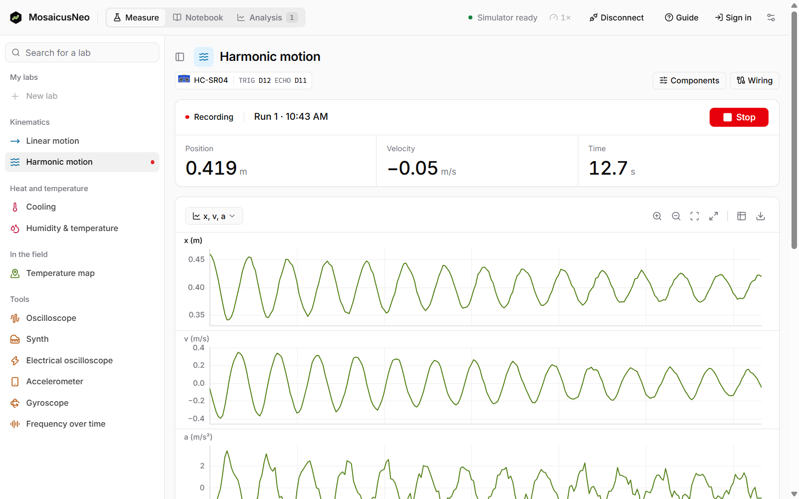
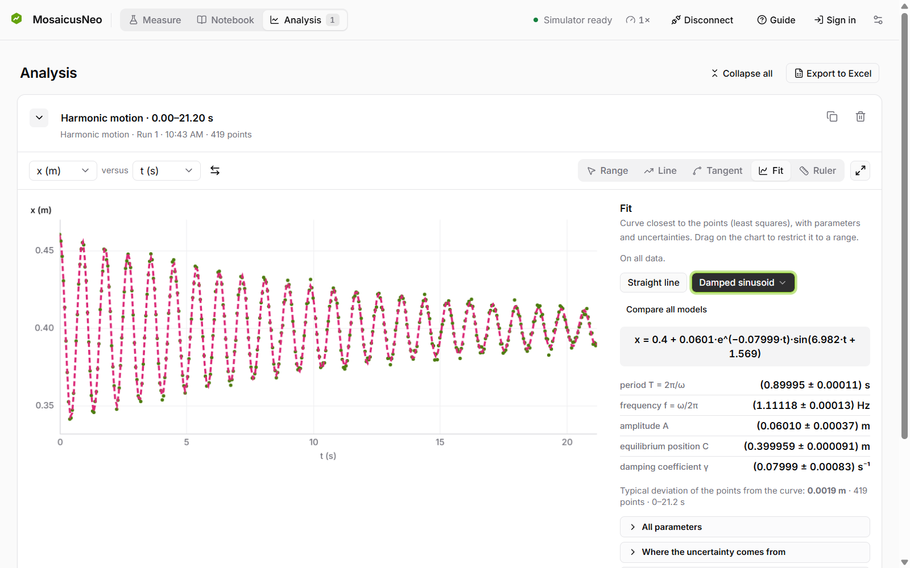
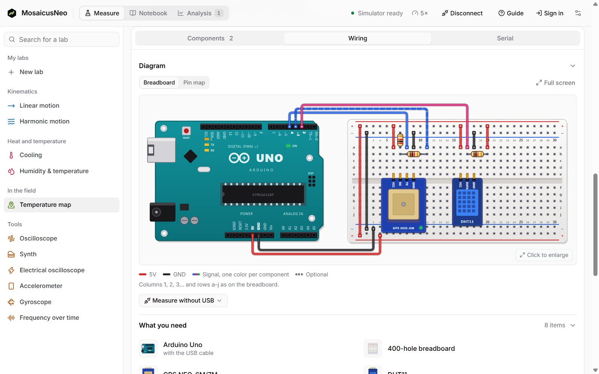

<p align="center"><b>English</b> · <a href="README.it.md">Italiano</a></p>

<p align="center">
  
</p>

<h1 align="center">MosaicusNeo</h1>

<p align="center">
  A free, open-source physics lab in your browser, built for high-school classes.<br />
  Plug sensors into an Arduino, record real data, and analyse it on the spot.
</p>

<p align="center">
  <a href="https://mosaicusneo.alexcorazza.com"><b>Open the app</b></a> ·
  <a href="#quick-start">Quick start</a> ·
  <a href="#hardware">Hardware</a> ·
  <a href="#development">Development</a> ·
  <a href="https://github.com/Alexciao/MosaicusNeo/issues/new">Report an issue</a>
</p>



## What it is

MosaicusNeo turns an Arduino Uno and a handful of cheap sensors into a small data-logging lab. You choose an experiment (or build your own lab from components), the app shows you exactly how to wire it, and then it reads every sensor at once and plots the results live. When you're done, you can fit a curve with uncertainties, check residuals, and export to Excel or CSV.

- **No installation.** It runs in Chrome or Edge on a computer (USB or Bluetooth), and on phones over Bluetooth. It also installs as an app and works offline.
- **No account needed.** Measurements stay in your browser. An optional account syncs them across devices.
- **No hardware needed to try it.** Every lab has a built-in simulator.
- **English and Italian** interface.

MosaicusNeo is based on [**Mosaicus**](https://ermesfrosi.it) by **Ermes Ferdinando Rosi**, released under the MIT license. The calculation engines (fitting, signal processing, canvas charts, formulas, XLSX export) come from Mosaicus. MosaicusNeo rebuilds the interface with Next.js, React and shadcn/ui, and adds modular sensors, generated wiring guides, Bluetooth and SD-card logging, and optional cloud sync.

## Screenshots

| Fit a model with uncertainties | Wiring guide generated from your components |
|---|---|
|  |  |

## Quick start

### Try it without hardware

1. Open [mosaicusneo.alexcorazza.com](https://mosaicusneo.alexcorazza.com).
2. Pick an experiment from the sidebar, for example **Harmonic motion**.
3. Click **Simulator** in the top bar, then **Start**. Watch the position, velocity and acceleration charts fill in.
4. Click **Stop**, then **Analyze the whole measurement**. In **Analysis**, choose **Fit** and try the suggested model.

### Use a real Arduino

1. **Upload the firmware once.** Open [`firmware/mosaicusneo_firmware/mosaicusneo_firmware.ino`](firmware/mosaicusneo_firmware/mosaicusneo_firmware.ino) in the Arduino IDE and upload it to an Arduino Uno. It needs no extra libraries.
2. **Pick a lab** in the sidebar: a ready-made experiment, or **My labs → New lab** to choose your own components.
3. **Wire it up.** Open the **Wiring** tab: it shows a breadboard diagram for your exact components and pins, a parts list, and step-by-step instructions, hole by hole.
4. **Connect.** Plug in the USB cable and click **Connect Arduino**. The app sends the sensor configuration to the board automatically.
5. **Measure.** Click **Start**. Name the run if you like; it is saved to the **Notebook** automatically.
6. **Analyse.** Drag across a chart to select a range, then send it to **Analysis**. There you can draw a line by eye, take a tangent, fit a model (line, parabola, exponential, damped sinusoid, …), check residuals, and measure with a ruler.
7. **Export.** Excel, CSV, PNG, GPX or GeoJSON. Raw sensor data is also available for Python, R or MATLAB.

The in-app **Guide** (top bar) covers all of this in more detail, including troubleshooting.

### Ready-made experiments

| Topic | Experiments |
|---|---|
| Kinematics | Linear motion, Harmonic motion |
| Heat and temperature | Cooling, Humidity & temperature |
| In the field | Temperature map (GPS + temperature) |
| Tools | Audio oscilloscope, Synth, Electrical oscilloscope (A0), phone accelerometer and gyroscope, Frequency over time |

You can change any experiment; your changes are saved as a new lab in **My labs**, and the original stays as it was.

## Hardware

Up to **6 sensors** at once on one Arduino Uno, even several of the same type (for example, two thermistors to compare two cups). Each one gets its own pins and reading rate, and the app checks for pin conflicts.

| Sensor | Pins | Measures |
|---|---|---|
| NTC thermistor (voltage divider) | A0–A5 | temperature, resistance |
| DHT11 / DHT22 | digital | temperature, relative humidity, dew point |
| HC-SR04 ultrasonic | TRIG + ECHO | position, velocity, acceleration |
| GPS NEO-6M/7M | RX (+ TX) | position, altitude, speed, distance |
| Photoresistor (voltage divider) | A0–A5 | relative light level |
| Analog voltage 0–5 V | A0–A5 | voltage, or a calibrated quantity y = k·V + q |
| DS18B20 probe (also waterproof) | digital + 4.7 kΩ | temperature (±0.5 °C) |
| Photogate / digital input | digital (D2/D3 for µs timing) | state, passages, period, blocking time, speed |
| Load cell + HX711 | DT + SCK | mass, force |
| MPU-6050 accelerometer (GY-521) | I2C | acceleration on 3 axes, angular velocity |
| MLX90614 infrared thermometer | I2C | contactless surface temperature |

**Extras** that don't count toward the 6 sensors:

- **Status outputs:** a 0.49" OLED display, an RGB LED and a buzzer, which show whether the board is waiting, searching, measuring or has a problem.
- **Start/Stop button:** works like the app's buttons, or starts SD logging on its own.
- **microSD card:** prepare the board once over USB, then it logs on battery power with no computer. Connect Arduino by USB and import the recordings into the Notebook (firmware 2.2); alternatively import the `.NEO` files directly from the card.
- **Bluetooth:** an HC-06 or a BLE module (HM-10, AT-09, HC-08) for measuring without a cable, for example outdoors with a phone and a power bank. BLE also works on iPhone through the Bluefy browser.

No Arduino at all? The phone's accelerometer, gyroscope and microphone work as sensors too.

### Browser support

| | USB cable | Bluetooth HC-06 | Bluetooth LE |
|---|---|---|---|
| Chrome / Edge on a computer | ✓ | if paired first | ✓ |
| Chrome on Android | – | ✓ (Chrome 138+) | ✓ |
| iPhone / iPad | – | – | in Bluefy |

Safari and Firefox don't support Web Serial or Web Bluetooth. You can still use the simulator, the phone sensors, the Notebook and Analysis.

## Privacy

Without an account, everything stays in your browser and nothing is sent anywhere. The microphone is only used live and is never recorded. There are no ads, analytics or tracking cookies. With an optional account, your measurements, panels, labs and preferences are stored on Supabase and are visible only to you; you can delete the account and all its data from the app at any time. Map tiles come from OpenStreetMap.

## Development

```bash
npm install
npm run dev        # http://localhost:3000
npm run build
npm run lint
npm run typecheck
```

Cloud sync is optional. To enable it, copy [`.env.example`](.env.example) and fill in your Supabase project; the database schema is in [`supabase/migrations`](supabase/migrations).

```
firmware/                     Arduino sketch (copied into public/ on each build)
src/lib/sensors/              component catalogue, presets, quantities, simulator
src/lib/lab-store.ts          Measure page: connection, protocol, data, sessions, export
src/lib/workbench-store.ts    Analysis panels and Excel export
src/lib/cloud/                Supabase account, local-first store, sync
src/lib/mosaicus/             engines from Mosaicus: fitting, DSP, canvas charts, formulas, XLSX
src/components/app/           Measure page, component editor, wiring guide, in-app guide, map
src/components/workbench/     Analysis page
src/components/instruments/   oscilloscope and synth
src/i18n/messages/            English and Italian text
```

<details>
<summary><b>How the firmware works</b></summary>

One sketch for every lab, with no external libraries: I2C, 1-Wire and a minimal FAT32 writer for the SD card are written from scratch. The app configures the board over serial (115200 baud), and the firmware sends back only raw readings: ADC counts, echo times, DHT bytes, NMEA fields. All conversions happen in the app, where they can be seen and calibrated.

```
CFG,CLEAR                                   → #ACK,CFG,CLEAR
CFG,ADD,<slot>,<NTC|ANA|DHT|SONAR|GPS|DS18|GATE|HX711|IMU|MLX>,<ms>,<pinA>,<pinB>,<opt>
                                            → #ACK,CFG,ADD,<slot> | #ERR,CFG,<slot>,<reason>
START                                       → #ACK,START, then D,<slot>,<t_ms>,<values…>
STOP · START,SCOPE,… (oscilloscope) · BT,SETUP (HC-06) · BT,SETUP,BLE · ID?
OUT,CLEAR · OUT,ADD,<OLED|RGB|BUZ|BTN|SD>,<p1>,<p2>,<p3>,<opt> · OUT,SAVE · OUT,TEST
CFG,SAVE,<id>                               → #ACK,CFG,SAVE   (configuration stored for SD logging)
SD,TEST                                     → #SD,OK,<MB> | #SD,ERR,<NOOUT|CARD|FAT32|FILE>
PING (every 2 s) · LINK,<U|B>               ← #ST,… on every status change · #KEY on button press
```

On the SD card, the firmware writes the same `D,…` lines to `LOG00001.NEO`, `LOG00002.NEO`, … after a header describing the configuration (`#MOSAICUSNEO,<fw>,SD`, `#PROJ,<id>`, `#CFG,…`, `#START`). Pins are numbers (A0 = 14 … A5 = 19); timestamps have 1 µs resolution on a 64-bit clock.

</details>

## Contributing

Bug reports, ideas for experiments, and pull requests are welcome. Open an [issue](https://github.com/Alexciao/MosaicusNeo/issues) to get started. If you're a teacher using MosaicusNeo in class, feedback on what works (and what doesn't) is especially useful.

## License and credits

MIT. © 2026 Ermes Ferdinando Rosi ([Mosaicus](https://ermesfrosi.it)). See [LICENSE](LICENSE) and [NOTICE.txt](NOTICE.txt), which also lists the third-party libraries and the Inter font license.
